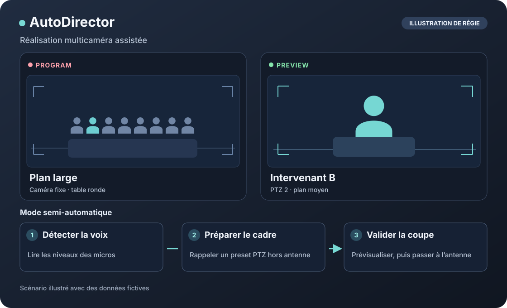

# AutoDirector

**Assistance à la réalisation de conférences multicaméras sur Mac.** AutoDirector transforme les niveaux des micros en propositions de cadrage. Le réalisateur peut prévisualiser le plan, déclencher la transition et suspendre l’automatisation pendant la prestation.

## De la voix à l’antenne

Dans une table ronde, chaque tranche audio est associée à un intervenant et à ses cadrages. Quand une voix prend le dessus, le moteur peut rappeler un preset sur une caméra PTZ hors antenne. En mode semi-automatique, l’opérateur charge la proposition en Preview puis déclenche la transition sur l’ATEM.

- **Préparation** · Le profil relie intervenants, tranches audio, caméras, presets et entrées vidéo.
- **Réalisation** · Le plan large sert de cadre de référence. Les PTZ utilisées en Program ou en Preview sont protégées des mouvements automatiques.
- **Reprise en main** · La commande **Freeze Automation** suspend les nouveaux ordres automatiques et annule ceux en attente.

## État du projet

La première application native utilise Swift et SwiftUI. Les intégrations ciblées sont un mélangeur Blackmagic ATEM, des Panasonic PTZ compatibles AW/IP et les consoles Behringer X32 et XR18 via OSC. La maquette hors ligne sert à explorer les scénarios. La qualification de la chaîne matérielle complète est en cours.

*Présentation du projet avec une illustration de régie et des données fictives.* [Voir le portfolio](https://github.com/LeQcho)
